## Системный монитор
**Автор:** Анисимов Д.С., группа И-43 
## CPU Usage (Использование процессора):
Считывает загрузку CPU через GetSystemTimes.
Показывает количество ядер (GetSystemInfo) и частоту процессора (через реестр).
Обновляет данные каждую секунду.
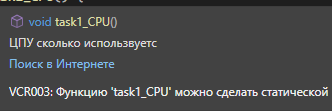

## RAM Monitoring (Мониторинг памяти):
Использует GlobalMemoryStatusEx.
Отображает общий объем ОЗУ, использованную и свободную память (в ГБ), а также процент загрузки.
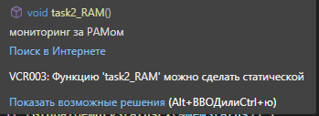

## Network Traffic (Сетевой трафик):
Использует GetIfTable для получения статистики по сетевым интерфейсам.
Считает разницу в байтах между вызовами, чтобы показать текущую скорость приема (RX) и передачи (TX) данных.
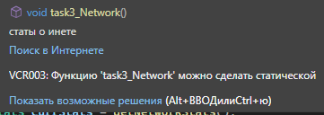

## Disk I/O (Дисковый ввод-вывод)
Использует DeviceIoControl с параметром IOCTL_DISK_PERFORMANCE для получения статистики чтения/записи с диска C:.
Показывает скорость чтения и записи в МБ/с.
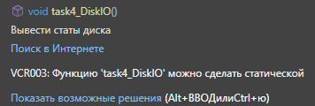

## Battery Status (Статус батареи):
Использует GetSystemPowerStatus.
Показывает процент заряда, статус (заряжается/разряжается), подключена ли зарядка и оставшееся время работы.
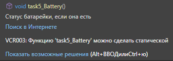

## Filesystem and Swap (Файловая система и подкачка):
Показывает свободное и занятое место на диске C: (через GetDiskFreeSpaceExA).
Показывает статистику использования файла подкачки (Swap/Pagefile) через GlobalMemoryStatusEx.
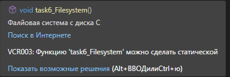

## Process Dynamics (Динамика процессов):
Делает снимок процессов (CreateToolhelp32Snapshot).
Считает общее количество процессов.
Ищет процесс, который потребляет больше всего оперативной памяти (через GetProcessMemoryInfo), и выводит его PID и имя.
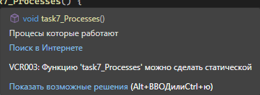

## System Load and Uptime (Нагрузка и время работы):
Показывает время с момента запуска системы (GetTickCount).
Дублирует текущую загрузку CPU.
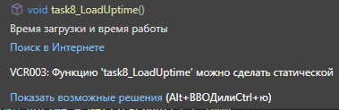

## Network Connections (Сетевые подключения):
Использует GetTcpTable.
Считает количество TCP-соединений и группирует их по состояниям (ESTABLISHED, LISTEN, TIME_WAIT и т.д.).
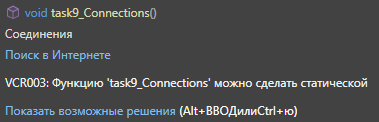

## Thermal Status (Тепловой статус):
Примечание: В данном коде этот пункт не считывает температуру напрямую (так как это сложно сделать стандартными средствами без драйверов), но он показывает имя процессора (из реестра) и статус питания/батареи.
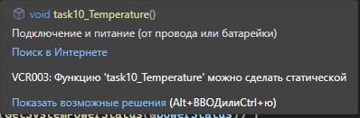

## Как запустить 
1. Открыть файл docs/ConsoleApplication21.sln в SharpDevelop или Visual Studio 
2. Нажать F5 
3. Появятся окна
## Скриншоты 
### Скриншот 1: Меню 
 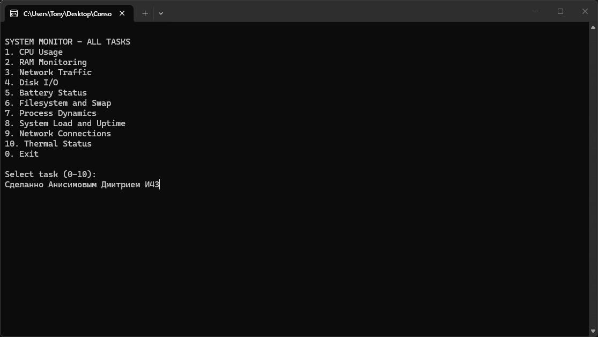 
### Скриншот 2: опция CPU
 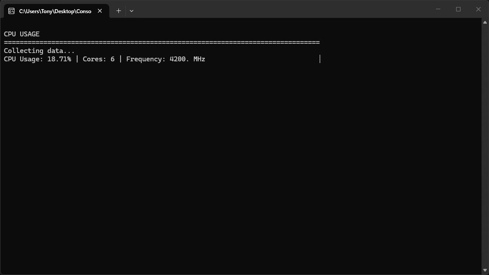 
### Скриншот 3: опция RAM
 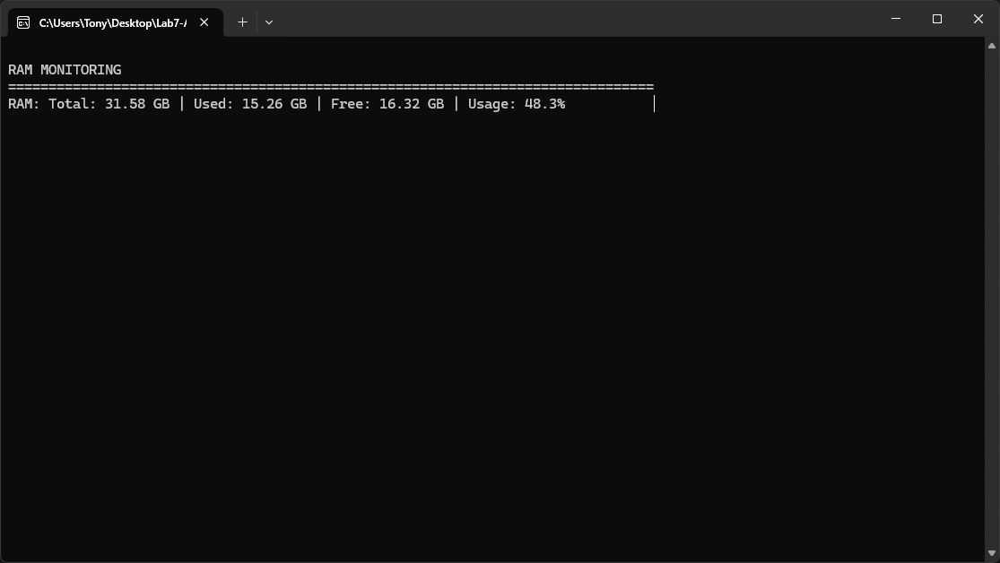 
### Скриншот 4: опция NETWORK TRAFFIC
 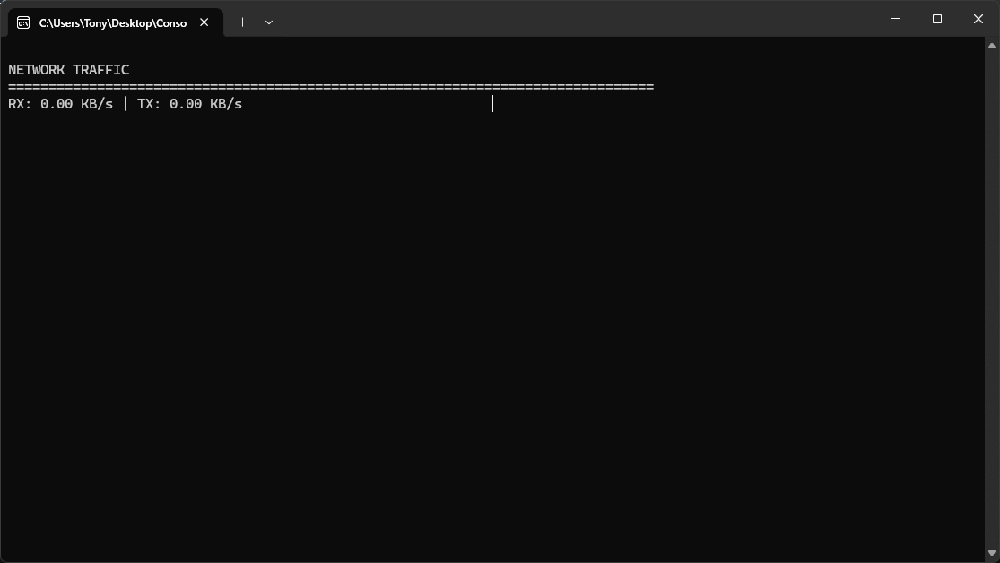 
### Скриншот 5: опция I/O
 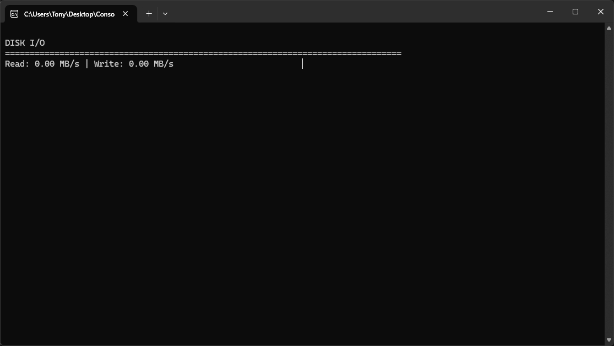 
### Скриншот 6: опция BATTERY STATUS
 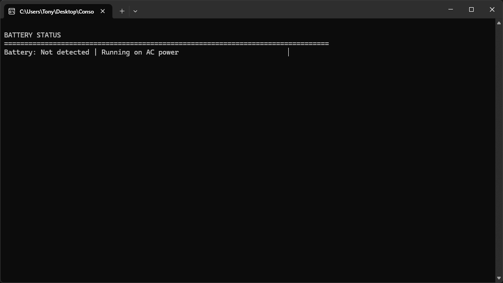 
### Скриншот 7: опция FILESYSTEM and SWAP
 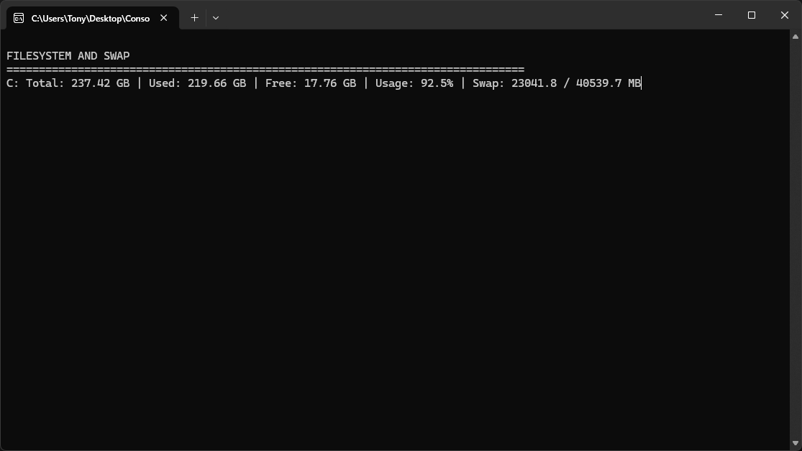 
### Скриншот 8: опция Process Dynamics
 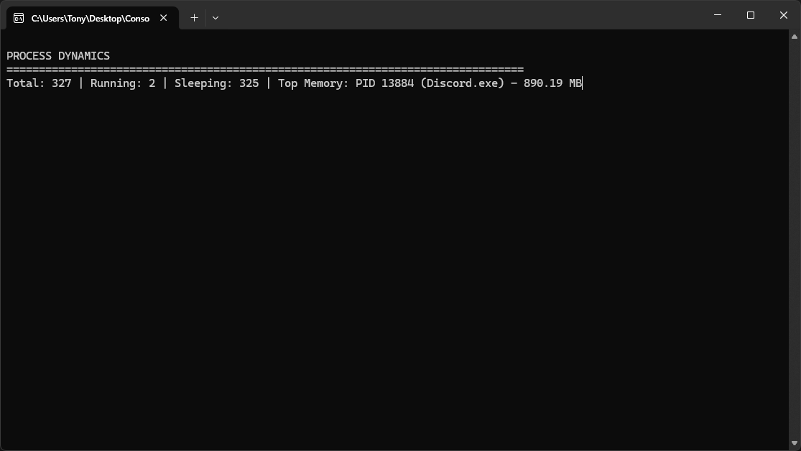
### Скриншот 9: опция SYSTEEM LOAD AND UPTIME
 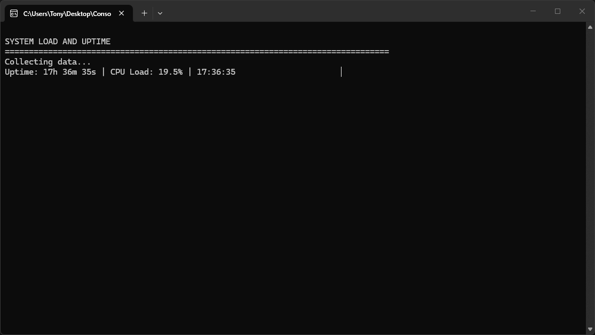  
### Скриншот 10: опция NETWORK CONNECTIONS
 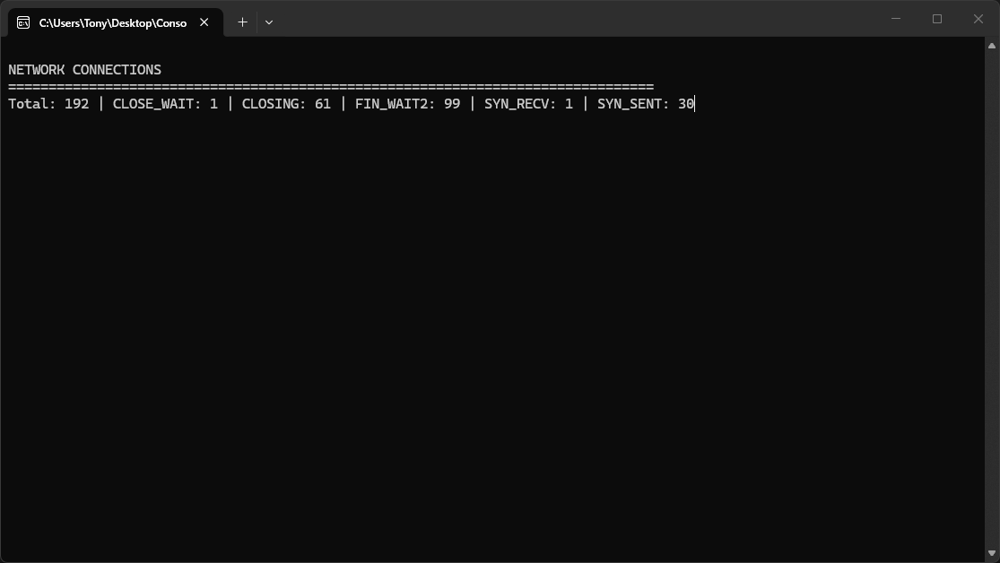 
### Скриншот 11: опция THERMAL STATUS
 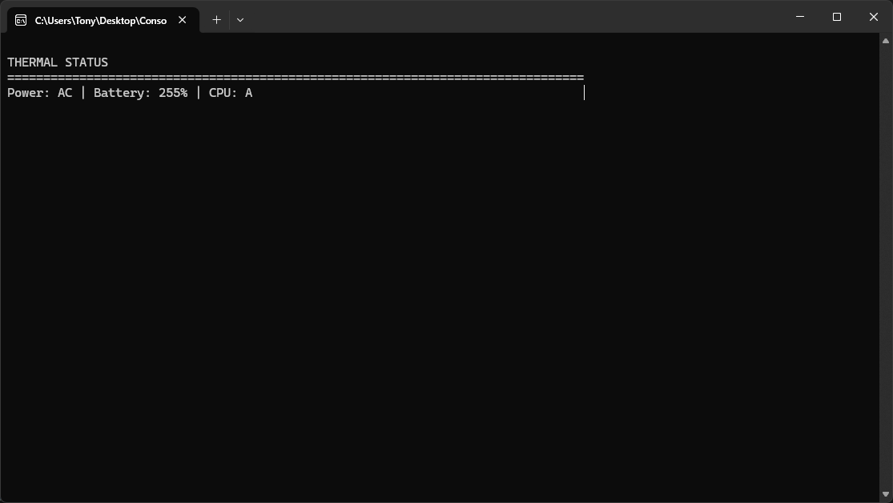
